# CERRA hackathon runs: interim results

Status on 18 Nov 2026, 19:00 CET. All six runs are unfinished: they were stopped
when the shared `wghack-course2026-cscs` account reached its node-hour limit.
Each run is configured for 64 mini-epochs of 4096 samples. Run definitions and
Slurm job ids are in `runs_cerra_hackathon.csv`.

Plots were made with `plot_train`; the numbers below are read from the same
training logs. Losses are MSE on normalised target channels, averaged over channels.
"FE" means the forecasting engine (16 blocks, trained from scratch).

## CERRA +3h forecast (targets `10si`, `r_850`)

| Run | Setup | Mini-epochs done | Samples at last validation | Validation MSE | `10si` | `r_850` |
|---|---|---|---|---|---|---|
| `mxtynk0b` | CERRA, no FE | 14 | 58,344 | 0.067 | 0.073 | 0.061 |
| `je43887w` | CERRA, FE | 12 | 50,152 | 0.105 | 0.112 | 0.098 |
| `rlufbwfc` | CERRA + ERA5 O96 input, no FE | 8 | 35,768 | 0.080 | 0.086 | 0.074 |
| `isk98cas` | CERRA + ERA5 O96 input, FE | 7 | 29,672 | 0.116 | 0.120 | 0.112 |

At a matched point of about 30,000 samples:

| Run | Samples | Validation MSE |
|---|---|---|
| `mxtynk0b` (CERRA, no FE) | 29,672 | 0.088 |
| `rlufbwfc` (CERRA + ERA5, no FE) | 31,672 | 0.083 |
| `isk98cas` (CERRA + ERA5, FE) | 29,672 | 0.116 |
| `je43887w` (CERRA, FE) | 29,672 | 0.137 |

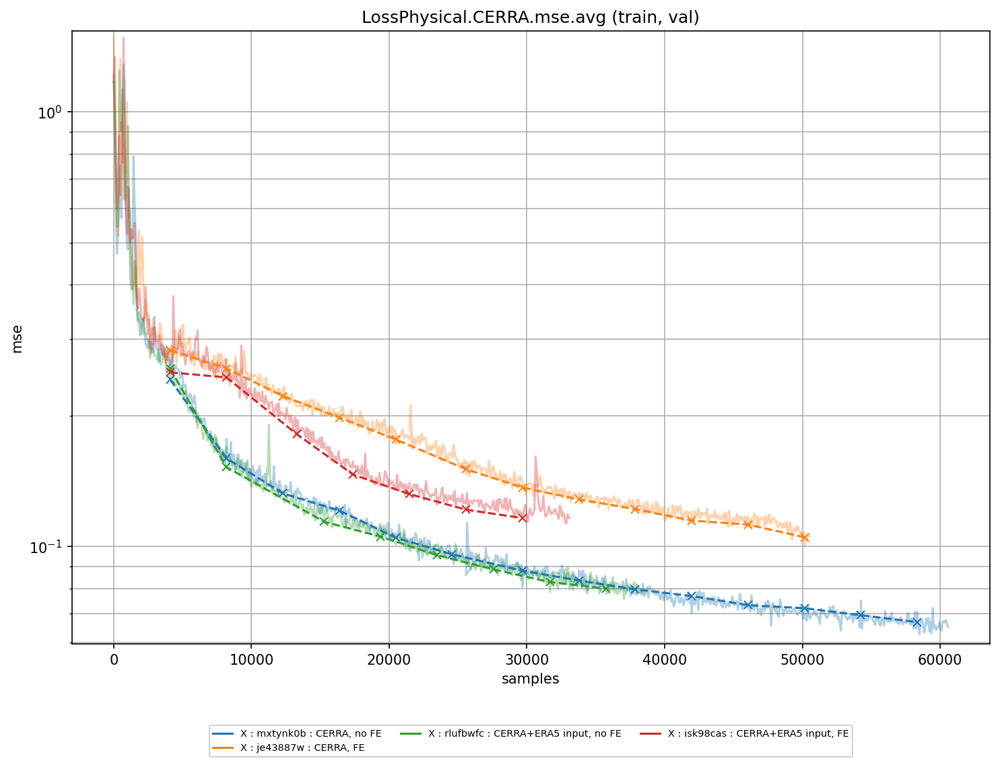

## ERA5 O96 only, +3h forecast (targets `10u`, `10v`, `q_850`)

| Run | Setup | Mini-epochs done | Samples at last validation | Validation MSE | `10u` | `10v` | `q_850` |
|---|---|---|---|---|---|---|---|
| `gjwg0n0v` | ERA5 only, no FE | 25 | 103,400 | 0.0085 | 0.0067 | 0.0098 | 0.0091 |
| `dwu8hmc7` | ERA5 only, FE | 17 | 69,536 | 0.0228 | 0.0192 | 0.0256 | 0.0237 |

At about 70,000 samples the run without the forecasting engine was at 0.0095
against 0.0228 with it.

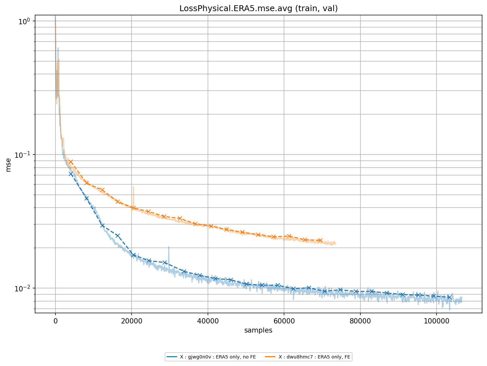

## What the curves show so far

- In all three pairs, the run with the forecasting engine has higher loss than
  the run without it at the same number of samples. The gap is narrowing slowly
  on CERRA and is roughly constant on ERA5.
- Adding ERA5 O96 as an extra input makes little difference without the
  forecasting engine (0.083 against 0.088 at about 30,000 samples). With the
  forecasting engine it helps more (0.116 against 0.137).
- Validation tracks training closely in every run, so there is no sign of
  overfitting yet.
- No run has flattened out. These are early numbers (11% to 39% of the planned
  training) and the ranking could still change.
- The CERRA and ERA5 losses are not comparable with each other: the target
  variables and grids differ.

## Throughput

| Run | Steps per second (4 GPUs) |
|---|---|
| `mxtynk0b` | 0.43 |
| `je43887w` | 0.35 |
| `rlufbwfc` | 0.33 |
| `isk98cas` | 0.29 |
| `gjwg0n0v` | 0.95 |
| `dwu8hmc7` | 0.66 |

## Reproducing the plots

```
plot_train -o plots/cerra_hackathon --legend-outside --streams CERRA \
  -fd "{'mxtynk0b': 'CERRA, no FE', 'je43887w': 'CERRA, FE', 'rlufbwfc': 'CERRA+ERA5 input, no FE', 'isk98cas': 'CERRA+ERA5 input, FE'}"
plot_train -o plots/cerra_hackathon --legend-outside --streams ERA5 \
  -fd "{'gjwg0n0v': 'ERA5 only, no FE', 'dwu8hmc7': 'ERA5 only, FE'}"
```

## Inference: scores, fields and spectra

Inference was run from the latest checkpoint of each run on 8 consecutive
3-hourly validation samples starting 2023-10-01 (+3h forecast, one step).
Eight samples from a single day is a small sample, and the checkpoints have
seen different amounts of training (7 to 25 mini-epochs, see above), so the
comparison between runs is indicative only.

### Scores

RMSE in physical units from `evaluate`. CERRA scores are over the `europe`
region (35 to 70 N, 10 W to 40 E); ERA5 scores are global.

| Run | Setup | Mini-epochs | RMSE `10si` [m/s] | RMSE `r_850` [%] |
|---|---|---|---|---|
| `mxtynk0b` | CERRA, no FE | 14 | 0.94 | 6.8 |
| `je43887w` | CERRA, FE | 12 | 1.18 | 8.9 |
| `rlufbwfc` | CERRA + ERA5 input, no FE | 8 | 1.05 | 7.4 |
| `isk98cas` | CERRA + ERA5 input, FE | 7 | 1.21 | 9.5 |

| Run | Setup | Mini-epochs | RMSE `10u` [m/s] | RMSE `10v` [m/s] | RMSE `q_850` [g/kg] |
|---|---|---|---|---|---|
| `gjwg0n0v` | ERA5 only, no FE | 25 | 0.49 | 0.50 | 0.41 |
| `dwu8hmc7` | ERA5 only, FE | 17 | 0.82 | 0.83 | 0.70 |

### CERRA fields, valid 2023-10-01 06:00

The model predicts a random subset of 375,000 of the 755,161 grid points per
sample (`max_num_targets`), which is why the maps have small gaps.

10 m wind speed (`10si`):

| | |
|---|---|
| Target 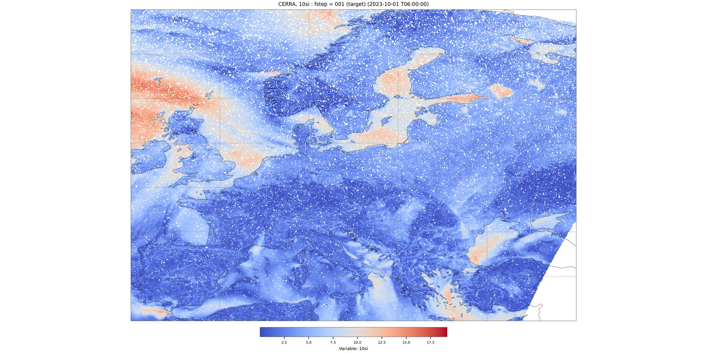 | |
| CERRA, no FE 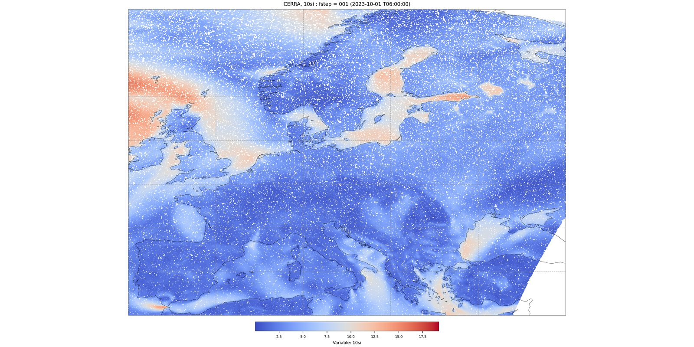 | CERRA, FE 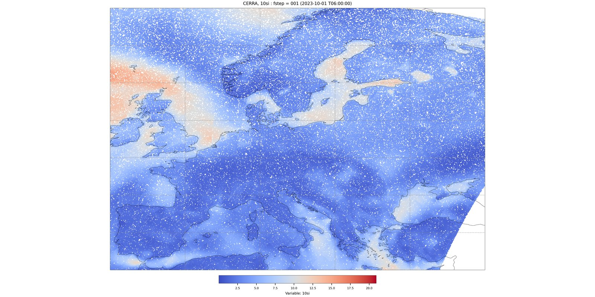 |
| CERRA + ERA5 input, no FE 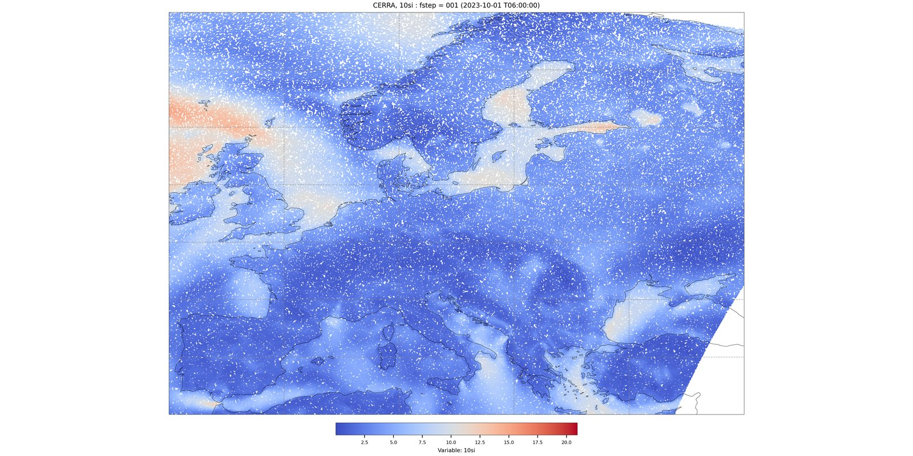 | CERRA + ERA5 input, FE  |

Relative humidity at 850 hPa (`r_850`):

| | |
|---|---|
| Target 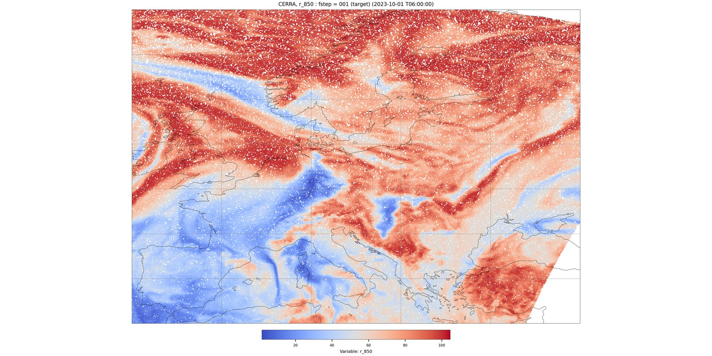 | |
| CERRA, no FE 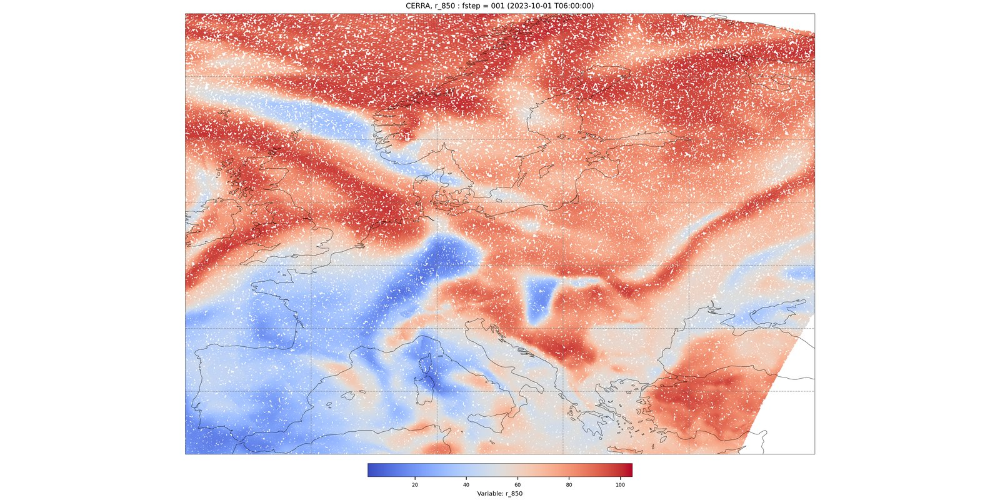 | CERRA, FE 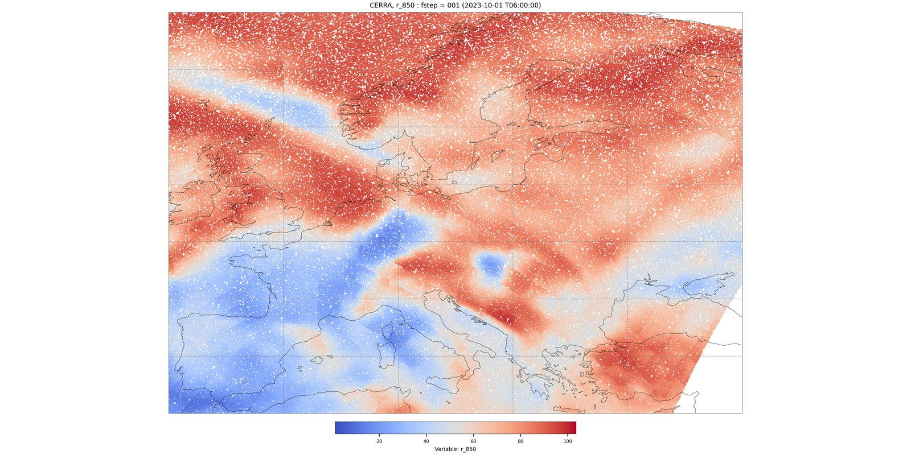 |
| CERRA + ERA5 input, no FE 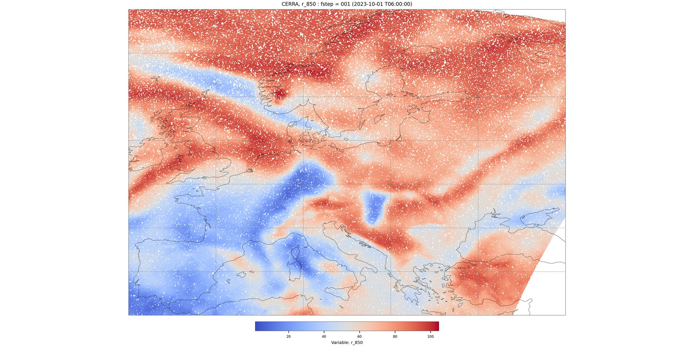 | CERRA + ERA5 input, FE 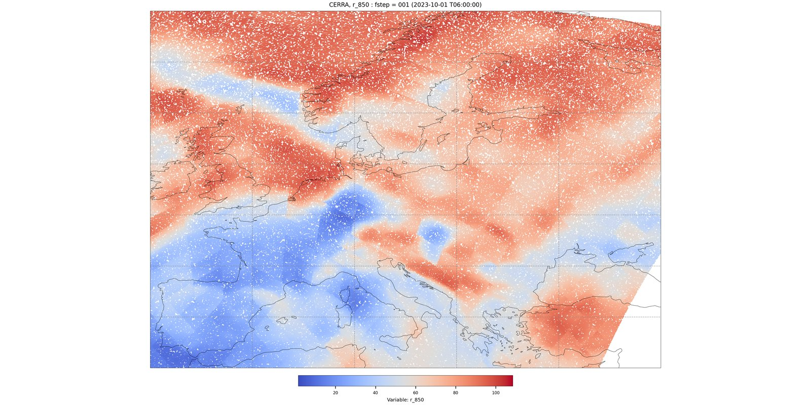 |

### ERA5 fields, 10 m zonal wind, valid 2023-10-01 06:00

| Target | No FE | FE |
|---|---|---|
|  | 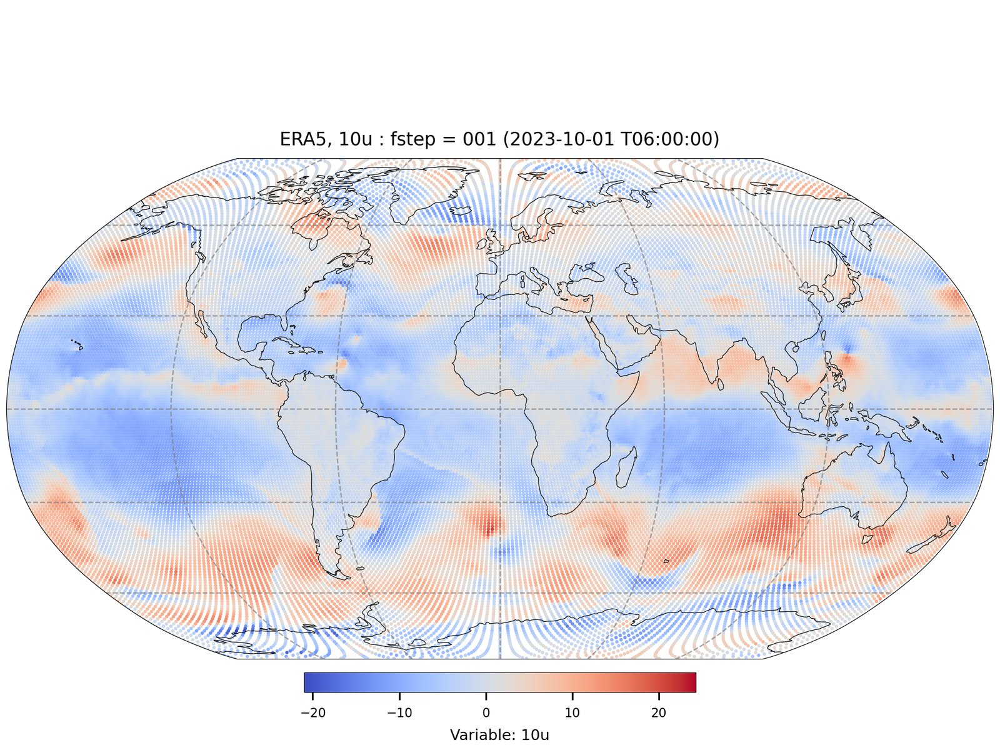 |  |

### CERRA spectra

The built-in `psd` metric needs a global or regular lat-lon grid, so it does
not apply to the scattered CERRA output. `scripts/cerra_hackathon_spectra.py`
interpolates predictions and targets from the same points onto a regular 11 km
grid in a Lambert conformal projection (3,600 km square box) and computes a
radially averaged 2-D FFT spectrum. The interpolation damps the smallest
scales, so wavelengths below about 50 km (grey band) should not be trusted.

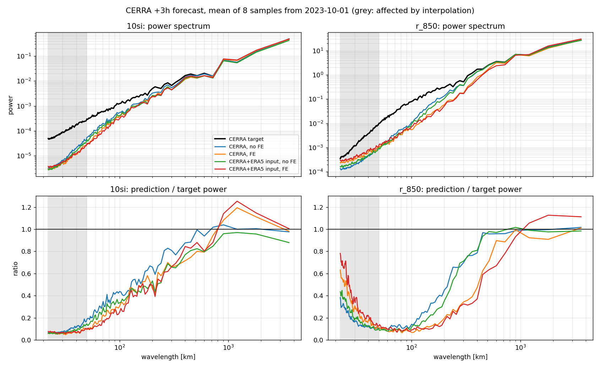

Ratio of predicted to target power:

| Run | `10si` 300 km | `10si` 100 km | `r_850` 300 km | `r_850` 100 km |
|---|---|---|---|---|
| CERRA, no FE | 0.81 | 0.44 | 0.70 | 0.14 |
| CERRA, FE | 0.66 | 0.31 | 0.34 | 0.07 |
| CERRA + ERA5 input, no FE | 0.66 | 0.34 | 0.71 | 0.12 |
| CERRA + ERA5 input, FE | 0.66 | 0.25 | 0.33 | 0.09 |

- All four runs are too smooth. Power is about right at wavelengths above
  roughly 1,000 km and falls increasingly short at smaller scales.
- Humidity is blurred much more than wind: at 100 km the predictions keep 7%
  to 14% of the target power for `r_850` against 25% to 44% for `10si`.
- The runs with the forecasting engine lose power at larger scales than the
  runs without it, most clearly for `r_850` (about 0.33 against 0.70 at 300 km).

### ERA5 spectra

Spherical-harmonic spectra from `evaluate` (`psd`, method `sht`). The x-axis is
the total wavenumber, although the plot labels it as frequency.

| | No FE | FE |
|---|---|---|
| `10u` | 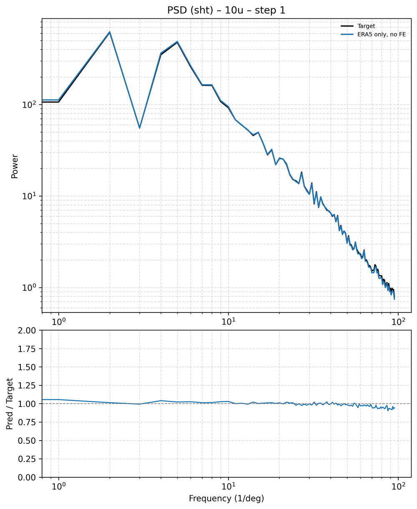 | 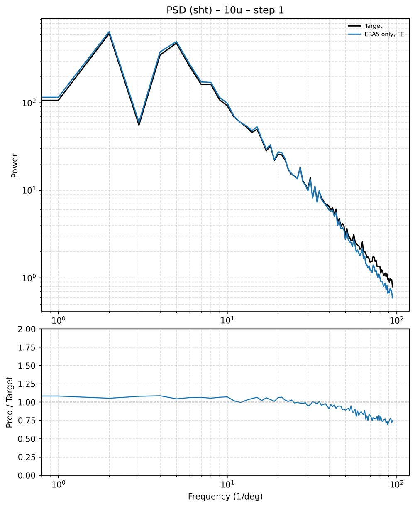 |
| `q_850` | 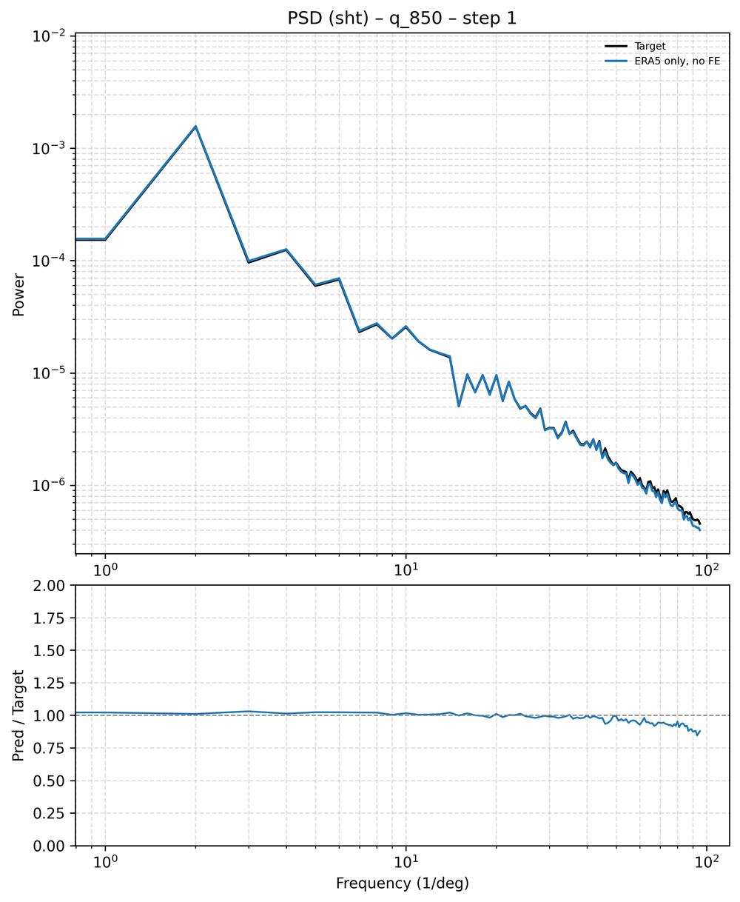 | 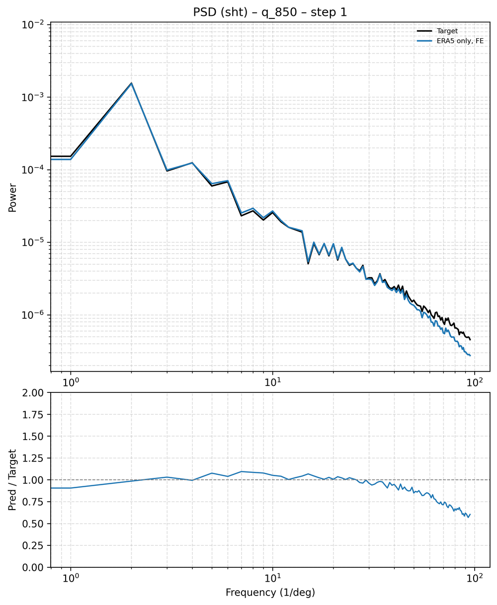 |

For `10u`, the run without the forecasting engine matches the target spectrum
to within a few percent up to the highest wavenumbers (ratio about 0.93 at
wavenumber 95). The run with the forecasting engine drops to about 0.75 there.

### Reproducing

```
sbatch scripts/cerra_hackathon_inference.sbatch
evaluate --config config/evaluate/eval_cerra_hackathon_cerra.yml
evaluate --config config/evaluate/eval_cerra_hackathon_era5.yml
python scripts/cerra_hackathon_spectra.py assets/cerra_hackathon/cerra_spectra.png \
  "mxtyinf0=CERRA, no FE" "je43inf0=CERRA, FE" \
  "rlufinf0=CERRA+ERA5 input, no FE" "isk9inf0=CERRA+ERA5 input, FE"
```

The inference run ids are the training run id's first four characters plus
`inf0`. Output paths in the job script and evaluation configs are specific to
this cluster account.
